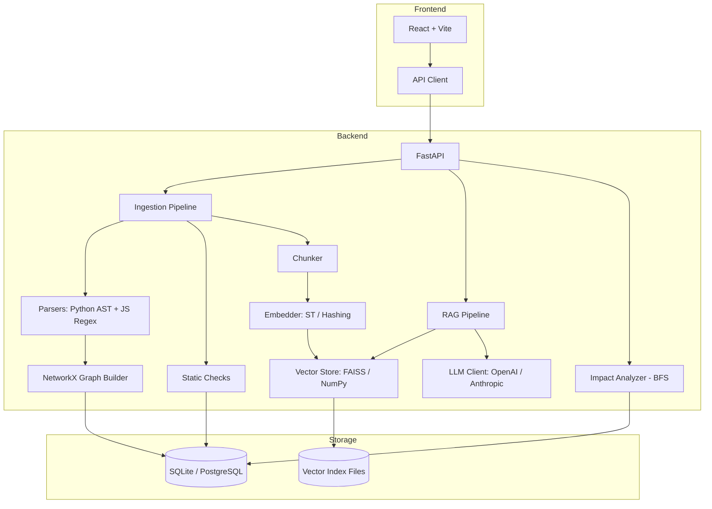

# Codebase Intelligence Platform

An AI-powered tool to analyze any GitHub repository or ZIP archive. Ask questions about the code, explore dependency graphs, detect security issues, and understand what changes may break.

## Architecture



## Setup with Docker

```bash
# Clone and configure
git clone <this-repo>
cd codebase-intel
cp .env.example .env
# Edit .env to set LLM_PROVIDER and your API key (optional)

# Start all services
docker compose up --build
```

Open [http://localhost:8080](http://localhost:8080) in your browser.

## Setup without Docker

### Backend

```bash
cd backend
pip install -r requirements.txt
# Optional: pip install sentence-transformers faiss-cpu openai anthropic
uvicorn app.main:app --reload --port 8000
```

### Frontend

```bash
cd frontend
npm install
npm run dev
```

Open [http://localhost:5173](http://localhost:5173). The Vite dev server proxies `/api` to port 8000.

## Setting API Keys

Copy `.env.example` to `.env` and set:

```env
# For AI-powered answers:
LLM_PROVIDER=openai        # or anthropic
OPENAI_API_KEY=sk-...      # your OpenAI key
# or
ANTHROPIC_API_KEY=sk-ant-... # your Anthropic key

# For private GitHub repos:
GITHUB_TOKEN=ghp_...
```

Without an API key, the chat endpoint still returns relevant code sections with a notice.

## Running Tests

```bash
# Backend tests (110 tests)
cd backend
python -m pytest tests/ -v

# Frontend tests (18 tests)
cd frontend
npm test

# Frontend build
cd frontend
npm run build
```

## Usage

1. **Import a repo**: Paste a GitHub URL (`https://github.com/owner/repo`) or upload a ZIP
2. **Explore**: Browse the file tree on the left; click a file to see symbols, imports, and issues
3. **Graph**: Switch to the Graph tab to see the dependency graph. Click nodes to select them
4. **Impact**: With a file selected, open the Impact tab and click "Analyze Impact"
5. **Issues**: Open the Issues tab to see security warnings, SQL risks, and complexity issues
6. **Chat**: Ask questions in natural language; sources are shown as clickable chips

## Demo Walkthrough

1. Start the app and navigate to [http://localhost:5173](http://localhost:5173)
2. Under "GitHub URL", enter `https://github.com/pallets/flask` and click Analyze
3. Wait for status to reach **Ready** (~30–60 seconds)
4. In the Graph tab, observe the import graph
5. Click `src/flask/app.py`, then open Impact → Analyze Impact
6. In Chat, ask: _"What does the before_request decorator do?"_

## Known Limitations

- **JS/TS parser is regex-based** (best-effort). Complex patterns like template literals in imports, dynamic `require()`, or decorator factories may not be detected
- **Dynamic imports** (`import()`, lazy imports) are not detected
- **Impact analysis is a static estimate**. Runtime imports, monkey-patching, and dependency injection are not captured
- **No code execution**: the tool only reads files; no sandboxed execution or type inference
- **Large repos** are capped at `MAX_FILES` (default 2000). Files beyond the cap are not analyzed
- **LLM hallucination**: even with real keys, LLMs may invent file names. The system prompt restricts this, but not perfectly
